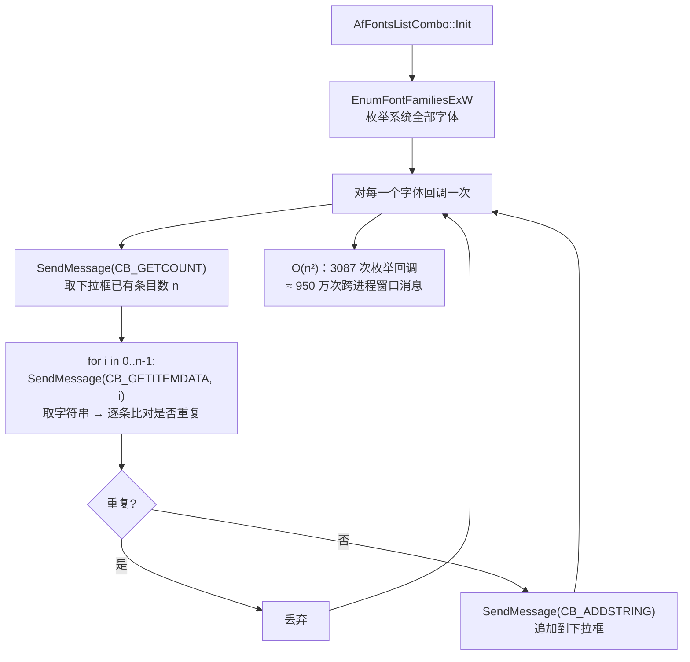
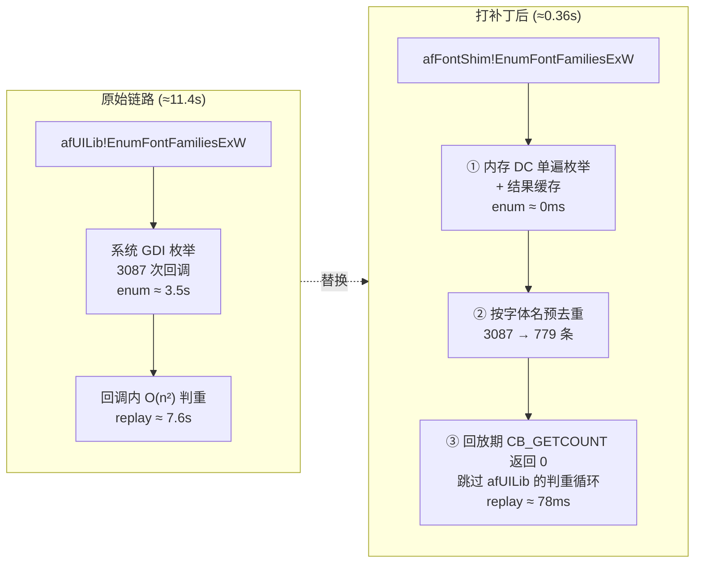

<div align="center">

</div>

<div align="center">

**让 ArcMap 10.2.x 的「标注」页签和字体下拉框，从「等十几秒」变成「点开就是」**

*Make the ArcMap 10.2.x Label tab and font dropdown open instantly instead of taking 10+ seconds.*

[](#兼容性--compatibility)
[-2b6cb0)](#兼容性--compatibility)
[](#实测效果--benchmarks)
[](#快速开始--quick-start)
[](LICENSE)
[](https://github.com/chunsanyue-rgb/arcmap-font-lag-fix/releases/latest)

[**中文**](#中文) · [**English**](#english)

</div>

---

## 中文

### 这是什么

一个**针对 ArcGIS Desktop 10.2.x 的现场补丁**，专门解决这个困扰无数 GIS 用户的经典卡顿：

> 图层右键 → 属性 → **标注** 页签，鼠标点下去之后界面直接"假死"，短则三五秒，长则十几秒才出内容；
> 标注标题下的 **符号** 按钮 → **编辑符号** → 字体下拉框，同样要等半天。
> 换个工程、重开对话框，又慢一遍。

这个问题 Esri 有官方缺陷编号 —— **BUG-000113336**，并在 **10.7 修复**，10.4.1 ~ 10.6.1 有官方补丁，**唯独 10.2.x 永远没有补丁**。所以很多还在用 10.2.2 的单位（尤其配合老版本扩展、老 .mxd 和老打印机符号库的作业环境）只能忍。

本项目把这个修复思路**自己实现了一遍**：不改 Esri 的安装包，不重打包 MSI，只在你本机的 ArcGIS `bin` 目录里做一次可回退的运行时重定向。实测 **11.4 秒 → 0.36 秒**，字体列表条目数与原生逻辑**逐条一致**。

### 你会遇到的现象

| # | 操作路径 | 症状 |
|---|---------|------|
| 1 | 图层右键 → 属性 → **标注** 页签 | 页面长时间空白/未响应，转圈 |
| 2 | 标注标题下的「符号…」→ **编辑符号** | 对话框要等数秒才弹出 |
| 3 | 上述对话框里的**字体下拉框** | 展开后长时间无响应 |
| 4 | 系统安装的字体越多 | 慢得越明显（本机 1111 种系统字体 ≈ 11 秒） |

只要满足以下条件，**基本可以确诊**：ArcGIS Desktop 版本 ≤ 10.6.x（尤其 10.2.x），且问题只在**首次**打开这些面板时最重、缓存后再次打开会快一些、换工程又变慢。

### 为什么慢（根因）

`afUILib.dll` 里 `AfFontsListCombo::Init` 的初始化流程是这样的：



关键点：**去重逻辑放在了回调里，而且用「遍历下拉框 + 逐条取字符串」的方式判重**。字体数量翻倍，比对次数就翻四倍。3087 次枚举回调 × 平均 3000 次消息 ≈ **950 万次内核窗口消息**，全部发生在 UI 线程上 —— 界面不假死才怪。

### 怎么修的（三层，逐层剥掉浪费）



| 层 | 做法 | 效果 |
|---|------|------|
| **① 单遍枚举 + 缓存** | 自己建一个内存 DC（`CreateCompatibleDC` + `GetDeviceCaps(LOGPIXELSY)`）来跑 `EnumFontFamiliesExW`，结果缓存在进程内，后续直接复用 | 枚举耗时 3.5s → **≈0ms** |
| **② 预去重** | 在回调前先按**字体名**去重（与 `afUILib` 自身判重口径完全一致），回调次数 3087 → **779** | 回放量 -75% |
| **③ 抑制判重循环** | 运行时把 `afUILib` 的 `SendMessageW` **IAT 槽**指向 shim；shim 在"本线程正在回放字体条目"期间让 `CB_GETCOUNT` 返回 0，afUILib 的 `for` 循环自然不进入，而 `CB_ADDSTRING` / `CB_SETITEMDATA` 照常执行 | 回放 328ms → **78ms** |

> 为什么敢让 `CB_GETCOUNT` 返回 0？因为 shim 侧**已经去过重**，afUILib 那层判重纯属白跑。最终送进下拉框的条目和条目顺序与原生逻辑**完全相同**（实测 779 条，逐条比对一致）。

**为什么用 shim 而不是直接改 `afUILib.dll` 的代码段？** 因为改代码段要处理指令长度、重定位、校验，任何一处算错就是启动崩溃；而改导入表只是**改写一个字符串指针 + 增加一个只读节**，字节级可逆、可校验、失败可拒绝安装。这就是所谓"最小侵入面"。

### 实测效果

同一台机器、同一个 .mxd、同一批系统字体（1111 种），修复前后对比：

| 指标 | 修复前 | 修复后 | 变化 |
|------|-------:|-------:|:----:|
| 首次打开「标注」页签（冷） | 11.4 s | **0.36 s** | **≈ 32×** |
| 再次打开（缓存命中） | 11.4 s | **0.27 s** | **≈ 42×** |
| 字体下拉框条目数 | 779 | 779 | 完全一致 |
| 枚举回调次数 | 3087 | 779 | -75% |
| 字体回放阶段耗时 | 328 ms | 78 ms | -76% |
| 功能/交互/出图 | — | — | 无任何业务逻辑改动 |

> 数值为单机实测，仅供量级参考；你的机器、字体数量、CPU 主频不同，绝对值会不同，但量级提升是稳定的。

### 快速开始

**前提**：Windows + ArcGIS Desktop 10.2.x，管理员权限。

```text
1. 下载 **[ArcMap-FontLag-Fix-v1.0.zip](https://github.com/chunsanyue-rgb/arcmap-font-lag-fix/releases/download/v1.0/ArcMap-FontLag-Fix-v1.0.zip)**（23 KB），解压到任意位置（别在压缩包里直接双击）
2. 保存并关闭所有 ArcGIS 程序（ArcMap / ArcCatalog / ArcScene / ArcGlobe）
3. 双击  01-安装_自动备份.bat   → UAC 弹窗点「是」
      它会自动：定位 ArcGIS bin 目录 → 备份原始 afUILib.dll → 安装 → 校验
4. 打开 ArcMap，点开「标注」页签验证
```

包里一共四个脚本，作用一眼能看懂：

| 脚本 | 作用 | 什么时候用 |
|------|------|-----------|
| `01-安装_自动备份.bat` | 备份 + 安装 + 校验（一条龙） | 正常安装 |
| `02-仅备份原文件.bat` | 只备份，不动任何文件 | 想先留个底，或自己手动装 |
| `03-回退还原.bat` | 还原到原始状态，可逐个选或一键全还原 | 出问题 / 想卸载 |
| `04-查看状态.bat` | 显示每个版本装没装、备份在哪、校验结果 | 排查 / 确认 |

### 它到底动了什么 / 没动什么

**动了（三处，全部在 ArcGIS `bin` 目录内）**

1. `afUILib.dll` 的**导入表**：把 gdi32 那一组导入的 DLL 名指向 `afFontShim.dll`（新增一个只读节 `.shim` 存放这个字符串，**不改任何代码段、不改任何 thunk**）；
2. 新增 `afFontShim.dll`（14 KB）—— 导出 `afUILib` 需要的**全部 47 个 gdi32 函数**（47 个纯透传 + 2 个钩子），所以整组重定向是安全的；
3. 新增 `afFontShim.ini` —— 配置与应急开关。

**没动**

- 不写注册表、不装服务、不装驱动、不驻留进程（进程退出即干净）
- 不改 `.mxd`、不改符号库、不改任何数据
- 不联网、不上传、不采集、无遥测
- 不打包、不反编译、不分发任何 Esri 二进制文件（MSI/MSP 一概不碰）

**备份位置**

```text
%ProgramData%\ArcMapFontFix\backup\<主机名>_<时间戳>_<版本>\
    ├─ afUILib.dll.orig     原始文件（字节级完整）
    └─ info.txt             原路径 / 大小 / 版本 / 时间戳
```

### 出问题怎么回退

**方式一（推荐）**：双击 `03-回退还原.bat`，选目录或直接回车全还原，1 秒钟回到原状。

**方式二（手动）**：
```text
把 %ProgramData%\ArcMapFontFix\backup\<...>\afUILib.dll.orig
复制回 <ArcGIS>\bin\afUILib.dll 覆盖，然后删除同目录的 afFontShim.* 两个文件
```

> **重要**：ArcGIS 做**修复安装 / 升级 / 打 Service Pack** 时会把 `afUILib.dll` 还原成原版，补丁随之失效 —— 这是正常现象，重跑一次 `01-安装_自动备份.bat` 即可。升级到 10.7 及以上就**不需要**本补丁了（官方已修）。

### 命令行工具 `afpatch.exe`

不想用 bat，或者要做批量部署，直接用底层工具（19 KB 原生程序，无依赖）：

```bat
afpatch.exe discover                 列出本机所有 ArcGIS 版本的 bin 目录
afpatch.exe check "<bin目录>"        是否已打补丁（0=原始 3=已打 其他=异常）
afpatch.exe verify  "<bin目录>"      校验：确认该 dll 的 gdi32 导入与补丁要求一致
afpatch.exe patch   "<bin目录>"      备份 + 打补丁（带校验，不符则拒绝）
afpatch.exe restore "<备份目录>"      从指定备份还原
afpatch.exe list                     列出全部备份
afpatch.exe version                  版本信息
```

安装脚本支持 `/auto` 静默模式（无交互、适合 SCCM / 域推送）：`01-安装_自动备份.bat /auto`

### 配置项 `afFontShim.ini`

出任何视觉/列表异常，先改这里，不用卸补丁：

| 键 | 默认 | 说明 |
|---|:---:|------|
| `enabled` | `1` | 置 0 = 完全透传，等于没装（用于 A/B 对比） |
| `dedupe_family` | `1` | 按字体名预去重（与 afUILib 口径一致）；置 0 可对照原生行为 |
| `use_memory_dc` | `1` | 用内存 DC 枚举；若字体列表异常可置 0 退回调用方 DC |
| `fast_combo` | `1` | 回放期让 `CB_GETCOUNT` 返回 0，跳过 O(n²) 判重；列表异常时置 0 |
| `log` | `1` | 在 DLL 同目录生成 `afFontShim.log`（含 enum_ms / replay_ms 分段耗时） |
| `charset_whitelist` | 空 | 字符集白名单，如 `1,2,134,136,255` 只保留常用；留空不限制 |

排查思路：`fast_combo=0` → 若恢复正常则问题在第三层；`use_memory_dc=0` → 若恢复正常则问题在第一层。日志里的 `enum_ms` / `replay_ms` 能直接告诉你时间花在哪。

### 兼容性 / Compatibility

| ArcGIS Desktop | 状态 | 说明 |
|---------------|------|------|
| 10.0 / 10.1 | 未测试 | 同架构，可能可用；安装前会校验导入表，不符则拒绝 |
| **10.2 / 10.2.1 / 10.2.2** | **实测通过（10.2.2）** | 本项目主要目标版本 |
| 10.3 / 10.3.1 | 未测试 | 同架构理论可用 |
| 10.4.1 ~ 10.6.1 | 不需要 / 可用 | Esri 有官方补丁，优先装官方 |
| 10.7 及以上 | **不需要** | 官方已彻底修复 |

安装器**自带安全闸**：打补丁前会校验目标 `afUILib.dll` 的 gdi32 导入表是否与预期结构一致，不一致就**拒绝安装**而不是硬改。所以拿到不匹配的版本上，它不会把 ArcMap 弄坏，只会告诉你"不支持"。

### 从源码构建

需要：Windows + [TinyCC 0.9.27 (win32)](https://bellard.org/tcc/) + Python 3.8+（仅用于生成/打包脚本）。

```bat
:: 1) 从 gen_shim.py 的函数清单生成 afFontShim.c（含 47 个导出）
python src\shim\gen_shim4.py

:: 2) 编译 shim DLL（-impdef 生成导入库）
tcc -shared -o afFontShim.dll src\shim\afFontShim.c afpatch_gdi32.def

:: 3) 把 _w_Xxx@N 形式的导出名改回真 GDI 名（等长字节填充）
python src\shim\patch_exports.py afFontShim.dll

:: 4) 编译补丁工具
tcc -o afpatch.exe src\afpatch\afpatch.c

:: 5) 打包发布目录（GBK + CRLF 的 bat，含自动备份/回退）
python src\package\build_pkg.py
```

细节与踩坑记录见 [`docs/HOW-IT-WORKS.md`](docs/HOW-IT-WORKS.md)，常见问题见 [`docs/FAQ.md`](docs/FAQ.md)。

### 已知限制

- 只解决**字体列表构建**这一条链路。ArcMap 里其他卡顿（大 .mxd 渲染、SDE 连接、地理处理）与本题无关。
- 补丁是**单机文件级**的，不做全局策略分发（但 `/auto` 静默模式可以配合域推送）。
- 极少数情况下如果字体下拉框出现空项/重复，按上文把 `fast_combo` 或 `use_memory_dc` 置 0 即可定位并规避。
- 本项目**不是** Esri 官方补丁，不受 Esri 技术支持覆盖。

### 免责声明（摘要）

> **本工具会修改你本机 ArcGIS 目录下的 `afUILib.dll`。虽已内置自动备份与一键回退，但仍存在不可预见风险（如 ArcMap 无法启动）。请务必：先备份、先在非关键机器/虚拟机上验证、生产环境谨慎评估。使用本工具的全部风险由使用者自行承担，作者不对任何数据丢失、工期延误、生产中断等后果负责。本工具与 Esri 公司无任何关联。**
>
> 完整条款见 [**DISCLAIMER.md**](DISCLAIMER.md)。

### 参考

- Esri Support — *BUG-000113336: The font list takes a long time to initialize in ArcMap* （10.7 修复；10.4.1 ~ 10.6.1 有官方补丁，10.2.x 无）
- 相关公开讨论：[CSDN 博文](https://blog.csdn.net/sinat_37215184/article/details/114946969)（10.8 之后才彻底解决）
- Microsoft Docs — *Import Address Table / PE format*、`EnumFontFamiliesExW`、`CreateCompatibleDC`

### 许可证

[MIT](LICENSE) © 2026 春三月。可自由使用、修改、分发，保留版权声明即可。

---

## English

### What this is

A **field patch for ArcGIS Desktop 10.2.x** that kills a classic piece of GIS misery:

> Right-click a layer → Properties → **Labels** tab, and the window hangs — five, ten, sometimes fifteen seconds before anything renders.
> Same story for the **Symbol** button under the label title → **Edit Symbol** → the font dropdown.
> Reopen the dialog or switch the map document, and you pay the price all over again.

Esri tracked this as **BUG-000113336** and fixed it in **10.7**, with official patches for 10.4.1 – 10.6.1 — but **10.2.x never got one**. Plenty of shops are still on 10.2.2 because their extensions, legacy .mxd files and symbol libraries depend on it, so they just live with the stall.

This project re-implements the fix independently: **no repackaged MSI, no patched Esri installer** — just a single reversible, runtime import-table redirection inside your local ArcGIS `bin` folder. Measured on the test machine: **11.4 s → 0.36 s**, with the font list **item-for-item identical** to the stock behaviour.

### Symptoms

| # | Where | What you see |
|---|-------|--------------|
| 1 | Layer → Properties → **Labels** | Long blank / "not responding" spinner |
| 2 | Label title → **Symbol…** → **Edit Symbol** | Dialog takes seconds to appear |
| 3 | The **font dropdown** in those dialogs | Hangs for a long time when opened |
| 4 | The more fonts installed | The slower it gets (1 111 installed fonts ≈ 11 s here) |

If you are on Desktop **≤ 10.6.x (especially 10.2.x)**, it is worst the *first* time each panel opens, gets faster after caching, and slows down again in a new map document — that pattern is the fingerprint.

### Root cause

Inside `afUILib.dll`, `AfFontsListCombo::Init` enumerates every system font and then, **inside the enumeration callback**, performs de-duplication by walking the target combo box and pulling each existing string back over window messages:

```text
3087 enumeration callbacks  ×  ~3000 SendMessage round-trips each  ≈  9.5 million window messages
```

That is O(n²) — double the fonts, quadruple the work — and it all runs on the UI thread. Hence the freeze.

### How it is fixed (three layers)

| Layer | Technique | Effect |
|-------|-----------|--------|
| **1. Enumerate once, cache the result** | Run `EnumFontFamiliesExW` against our own memory DC (`CreateCompatibleDC` + `GetDeviceCaps(LOGPIXELSY)`), cache per process | enumeration 3.5 s → **≈ 0 ms** |
| **2. De-duplicate *before* the callback** | Collapse by **font name** — the exact same key `afUILib` itself uses — 3087 → **779** callbacks | −75% replay volume |
| **3. Suppress the O(n²) loop** | Point the `SendMessageW` **IAT slot** of `afUILib` at the shim; while the calling thread is replaying font items, the shim answers `CB_GETCOUNT` with 0, so the stock `for` loop never runs — while `CB_ADDSTRING` / `CB_SETITEMDATA` still do | replay 328 ms → **78 ms** |

Why is answering `CB_GETCOUNT` with 0 safe? Because the shim has **already** de-duplicated — the stock comparison pass is pure wasted work. The final item set and item order match the original logic exactly (verified: 779 items, compared one by one).

**Why a shim instead of patching `afUILib.dll`'s code?** Rewriting code means handling instruction lengths, relocations and checksums — one wrong byte means a crash on startup. Rewriting the import descriptor is just *one string pointer plus one read-only section*: byte-level reversible, verifiable, and refusable when the target DLL doesn't match.

### Benchmarks

Same machine, same .mxd, same 1 111 installed fonts:

| Metric | Before | After | Delta |
|--------|-------:|------:|:-----:|
| First open of the **Labels** tab (cold) | 11.4 s | **0.36 s** | **≈ 32×** |
| Re-open (cache hit) | 11.4 s | **0.27 s** | **≈ 42×** |
| Font items in the dropdown | 779 | 779 | identical |
| Enumeration callbacks | 3087 | 779 | −75% |
| Font replay phase | 328 ms | 78 ms | −76% |
| Functional / behavioural change | — | — | none |

> Single-machine numbers, for order-of-magnitude reference only. Your hardware and font count will shift the absolutes; the magnitude is stable.

### Quick start

**Requires** Windows + ArcGIS Desktop 10.2.x, administrator rights.

```text
1. Download **[ArcMap-FontLag-Fix-v1.0.zip](https://github.com/chunsanyue-rgb/arcmap-font-lag-fix/releases/download/v1.0/ArcMap-FontLag-Fix-v1.0.zip)** (23 KB) and extract it (do not run it inside the zip)
2. Save your work and close every ArcGIS app (ArcMap / ArcCatalog / ArcScene / ArcGlobe)
3. Run  01-安装_自动备份.bat  → click "Yes" on the UAC prompt
      it locates the ArcGIS bin folder, backs up afUILib.dll, installs, then verifies
4. Open ArcMap and click the "Labels" tab
```

| Script | Purpose |
|--------|---------|
| `01-安装_自动备份.bat` | Backup + install + verify (all in one) |
| `02-仅备份原文件.bat` | Backup only — change nothing |
| `03-回退还原.bat` | Restore original state (per-directory or all) |
| `04-查看状态.bat` | Show patch state, backup location, verification result |

> Script contents and console output are in Simplified Chinese (GBK). English-speaking users can drive `tool\afpatch.exe` directly — see below.

### What it changes / what it does not

**Changed — three things, all inside the ArcGIS `bin` folder**

1. the **import descriptor** of `afUILib.dll`: the gdi32 group is retargeted to `afFontShim.dll` (a new read-only `.shim` section carries the name; **no code section and no thunk is touched**);
2. added `afFontShim.dll` (14 KB) exporting **all 47 gdi32 functions** `afUILib` imports (47 pass-throughs + 2 hooks), which is why retargeting the whole group is safe;
3. added `afFontShim.ini` for configuration and emergency switches.

**Never touched**

- No registry writes, no services, no drivers, no resident process (exits clean with the app)
- No change to `.mxd`, symbol libraries or your data
- No network access, no telemetry, no data collection
- No repackaging or redistribution of any Esri binary (MSI/MSP untouched)

**Backup location**

```text
%ProgramData%\ArcMapFontFix\backup\<host>_<timestamp>_<version>\
    ├─ afUILib.dll.orig     byte-exact original
    └─ info.txt             original path / size / version / timestamp
```

### Rollback

Double-click `03-回退还原.bat` (fastest), or manually copy `afUILib.dll.orig` from the backup folder back over `<ArcGIS>\bin\afUILib.dll` and delete the two `afFontShim.*` files.

> **Note:** an ArcGIS **repair install / upgrade / service pack** restores the original `afUILib.dll`, so the patch stops applying — just re-run `01-安装_自动备份.bat`. Upgrading to 10.7+ makes this patch unnecessary (Esri fixed it).

### CLI — `afpatch.exe`

A 19 KB native tool with no dependencies, handy for scripting or mass deployment:

```bat
afpatch.exe discover                 list every ArcGIS bin folder found on this machine
afpatch.exe check "<bin>"            patch state (0 = original, 3 = patched, other = anomaly)
afpatch.exe verify "<bin>"           verify the gdi32 import table matches what the shim expects
afpatch.exe patch "<bin>"            backup + apply (refuses on mismatch)
afpatch.exe restore "<backup dir>"   restore from a specific backup
afpatch.exe list                     list all backups
afpatch.exe version                  version info
```

The install script also accepts `/auto` for unattended deployment (SCCM / GPO friendly).

### Configuration `afFontShim.ini`

Tune behaviour without uninstalling:

| Key | Default | Meaning |
|-----|:-------:|---------|
| `enabled` | `1` | `0` = pure pass-through (A/B comparison) |
| `dedupe_family` | `1` | Pre-de-duplicate by font name; `0` to mimic stock behaviour |
| `use_memory_dc` | `1` | Enumerate via memory DC; `0` to fall back to the caller's DC |
| `fast_combo` | `1` | Answer `CB_GETCOUNT` with 0 during replay; `0` to restore the O(n²) loop |
| `log` | `1` | Write `afFontShim.log` with per-phase `enum_ms` / `replay_ms` timings |
| `charset_whitelist` | empty | e.g. `1,2,134,136,255` to keep only common charsets |

Triage: set `fast_combo=0` — if it recovers, layer 3 is implicated; set `use_memory_dc=0` — if it recovers, layer 1 is. The log tells you where the time went.

### Compatibility

| ArcGIS Desktop | Status | Note |
|---------------|--------|------|
| 10.0 / 10.1 | Untested | Same architecture; installer verifies imports and refuses on mismatch |
| **10.2 / 10.2.1 / 10.2.2** | **Verified (10.2.2)** | Primary target |
| 10.3 / 10.3.1 | Untested | Same architecture, expected to work |
| 10.4.1 – 10.6.1 | Not needed / works | Prefer the official Esri patch |
| 10.7 and later | **Not needed** | Fixed upstream |

The installer ships a **safety gate**: before patching it verifies the gdi32 import table of the target `afUILib.dll`, and **refuses to install** rather than force a rewrite. On an unsupported build it will tell you so instead of breaking ArcMap.

### Build from source

Windows + [TinyCC 0.9.27 (win32)](https://bellard.org/tcc/) + Python 3.8+ (scripts only):

```bat
python src\shim\gen_shim4.py                              :: generate afFontShim.c (47 exports)
tcc -shared -o afFontShim.dll src\shim\afFontShim.c afpatch_gdi32.def
python src\shim\patch_exports.py afFontShim.dll          :: rename _w_Xxx@N back to real GDI names
tcc -o afpatch.exe src\afpatch\afpatch.c
python src\package\build_pkg.py                          :: build the release folder (bat files, GBK/CRLF)
```

Design notes and war stories: [`docs/HOW-IT-WORKS.md`](docs/HOW-IT-WORKS.md). FAQ: [`docs/FAQ.md`](docs/FAQ.md).

### Limitations

- Covers the **font-list construction path only**. Other ArcMap slowness (huge .mxd rendering, SDE, geoprocessing) is unrelated.
- File-level, per-machine. No central policy channel — but `/auto` works with domain push.
- In rare cases a blank/duplicate entry may appear in the dropdown; set `fast_combo=0` or `use_memory_dc=0` to isolate and avoid.
- **Not** an Esri official patch; not covered by Esri support.

### Disclaimer (summary)

> **This tool modifies `afUILib.dll` inside your ArcGIS installation. Automatic backup and one-click rollback are built in, but unforeseeable risk remains (e.g. ArcMap failing to start). Back up first, test on a non-critical machine or VM, and assess carefully before production use. You bear all risk; the author is not liable for data loss, schedule delays or downtime. This project is not affiliated with Esri.**
>
> Full terms: [**DISCLAIMER.md**](DISCLAIMER.md).

### References

- Esri Support — *BUG-000113336: The font list takes a long time to initialize in ArcMap* (fixed in 10.7; official patches for 10.4.1 – 10.6.1; none for 10.2.x)
- Community write-up: [CSDN article](https://blog.csdn.net/sinat_37215184/article/details/114946969) (fully resolved only after 10.8)
- Microsoft Docs — PE/Import Address Table, `EnumFontFamiliesExW`, `CreateCompatibleDC`

### License

[MIT](LICENSE) © 2026 春三月 (Chun San Yue).

---

<div align="center">

**如果这个补丁帮你省下了每天那几十次十几秒的等待，点个 Star 就好。**

*If this saved you a dozen 10-second waits a day, a star is enough thanks.*

</div>
